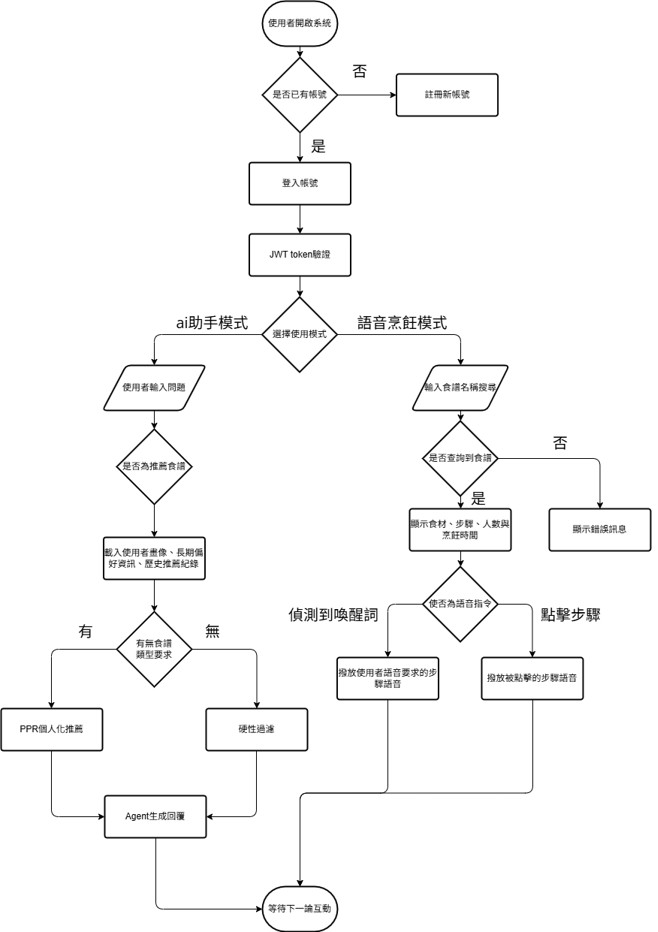

# 推甄備審資料：作品與研究整理

| 資料夾 | 內容 |
|---|---|
| `An-Agent-Based-Personalized-Recipe-Recommendation-System-Combining-GDS-and-Memory-Mechanisms/` | 專題：Agent 個人化食譜推薦系統 |
| `Research_Project/` | 國科會大專生計畫：健身房契約審查系統 |
| `Artificial_Intelligence/` | 人工智慧課程：神經網路參數搜尋 |
| `operating_system/` | 作業系統課程：多行程 vs 多執行緒 |
| `Programming_Languages/` | 程式語言（一）：C++ 貪食蛇 |

---

## 1. 專題：結合 GDS 與記憶機制之 Agent 個人化食譜推薦系統

系統分為 **LLM（AI 助手）** 與 **語音烹飪** 兩大模式。成果已投稿 TANET 2026 暨 ICS；記憶機制相關研究投稿 TAAI 2026。



**核心技術**
- **知識圖譜**：以 Neo4j 建立食譜知識圖譜
- **兩階段 Hybrid RAG**：BGE 中文 Embedding + Vector Index 以 ANN 取得候選食譜 → 以候選為種子節點，在投影子圖上執行 Personalized PageRank（PPR）重排
- **食材替代**：形式化為知識圖譜連結預測，比較 TransE 與 RotatE（MRR、Hits@10），最終採用 RotatE
- **語音烹飪**：Porcupine 本地喚醒詞 → WebRTC VAD → Faster Whisper → WebSocket 推送前端 → Edge TTS 播放
- **前後端**：React + FastAPI

**專案結構**
```
.
├── neo4j/              # 知識圖譜資料處理、建置
├── back_end/           # 後端服務（FastAPI、Agent、記憶、語音模組）
├── front_end/          # 前端介面
├── KG/                 # KGE 模型訓練
├── .env_example        # 環境變數範本
├── requirements.txt    # Python 套件
└── README.md
```

**我的負責項目**
- 知識圖譜建置、ANN 召回、PPR 重排
- RotatE 食材替代模型訓練與應用
- 語音互動模組（喚醒詞、WebRTC VAD、Faster Whisper、Edge TTS）
- 前後端系統串接

---

## 2. 國科會大專生計畫：基於 Hybrid RAG 與 MOT 架構之健身房契約審查系統

解決 LLM 長文本迷失問題，獨立開發。將健身房契約逐條與「範本 → 應記載/不得記載事項 → 消費者保護法」比對，產生審查報告。

**方法比較**
1. 純向量檢索：搜尋全部相關資料
2. Hybrid RAG + MOT：向量相似度找出對應範本條文 → 沿人工建立的固定圖關係查找應記載事項與消保法條文 → 以 Jaccard 相似度計算子圖節點重疊，超過門檻則合併為群集

**初步結果**

| 方法 | 法條命中率 |
|---|---|
| 純向量檢索 | 12.5% |
| Hybrid RAG + MOT | 87.5%（約 7 倍） |

**專案結構**
```
Research_Project/
├── data/
│   ├── raw/                          # 原始資料
│   │   ├── consumer_protection_law.txt   # 消費者保護法
│   │   ├── template.txt                  # 健身中心定型化契約範本
│   │   ├── mandatory_items.txt           # 應記載及不得記載事項
│   │   ├── wrong_contract.txt            # 待審查的錯誤契約（測試用）
│   │   └── ground_truth.json             # 標準答案（17 條違規、21 條未改動）
│   ├── processed/                    # 切分後節點（執行 preprocess.py 產生）
│   ├── embeddings/                   # Embedding 快取（執行 build_kg.py 產生）
│   ├── retrieval/                    # BFS / MOT 檢索結果
│   ├── reports/                      # 審查報告與 grid search 結果
│   └── evaluation/                   # 評估結果
└── src/
    ├── preprocess.py                 # 文本切分（法條→項、範本→條、應記載事項→點）
    ├── build_kg.py                   # 建立 Neo4j 知識圖譜（節點與 BASED_ON / IMPLEMENTS 邊）
    ├── retriever.py                  # 向量檢索 + BFS 兩跳擴展
    ├── mot.py                        # MOT：子圖 Jaccard 合併與排序
    ├── generator.py                  # LLM 產生審查報告（含 Rule-based 檢查）
    └── evaluator.py                  # 評估：Precision / Recall / F1、法條命中率、grid search、基準比較
```

**執行流程**（腳本會自動切換到專案根目錄，可在任何位置執行）
```bash
python src/preprocess.py   # 1. 切分文本
python src/build_kg.py     # 2. 建立知識圖譜（需啟動 Neo4j）
python src/retriever.py    # 3. BFS 檢索
python src/mot.py          # 4. MOT 合併與排序
python src/generator.py    # 5. 產生審查報告
python src/evaluator.py    # 6. 評估
```
需在專案根目錄建立 `.env`：`OPENAI_API_KEY`、`NEO4J_URI`、`NEO4J_USER`、`NEO4J_PASSWORD`。

**圖譜設計**：節點為 `LawArticle`、`TemplateClause`、`MandatoryItem`；邊為 `BASED_ON`（範本/應記載事項 → 法條）與 `IMPLEMENTS`（範本 → 應記載事項）。待審契約僅作查詢輸入，不存入圖譜。

---

## 3. 人工智慧：雙隱藏層神經網路與參數搜尋

- 結構 5 → 20 → H2 → 1；資料（熱杯子五指溫度）切分 6 : 2 : 2（訓練 / 驗證 / 測試）
- 第一層固定 20，第二層 H2 由 3 到 20 逐一測試；每組以 3 個 Random Seed 訓練，計算驗證準確率平均與標準差並繪製誤差線圖
- **結果**：H2 = 13 最佳，平均驗證準確率約 72.73%，標準差約 2.18%，並以最佳結構在測試集評估

**專案結構**（單一資料夾，無子目錄）
```
Artificial_Intelligence/
├── cup_2layer.py                 # 主程式：5→20→H2→1 參數搜尋與評估
├── cup_nn_train_data.csv         # 資料
├── hidden2_runs.csv              # 輸出：每個 H2、每次 run 的 train/valid 準確率
├── hidden2_summary.csv           # 輸出：每個 H2 驗證準確率的平均與標準差
└── hidden2_validation_curve.png  # 輸出：H2 vs 驗證準確率誤差線圖
```

**執行**：需在資料夾內執行（程式以相對路徑讀取 CSV）
```bash
cd Artificial_Intelligence
python cup_2layer.py
```

---

## 4. 作業系統：多行程 vs 多執行緒登入驗證伺服器

- 以 `fork`（多行程）與 `thread`（多執行緒）分別實作伺服器端
- 模擬 10、50、100、200 個併發登入請求，以互斥鎖確保共享計數正確
- 量測登入成功次數、CPU 時間、記憶體與上下文切換次數，比較兩種架構的資源開銷

---

## 5. 程式語言（一）：C++ 主控台貪食蛇

- 使用 `windows.h` 控制游標，以 `conio.h` 的 `_kbhit()`、`_getch()` 處理鍵盤輸入
- 物件導向設計：`Snake`、`Egg`、`Wall`、`GM` 分別管理蛇、食物、牆壁與遊戲流程
- 蛇身以固定大小陣列儲存座標；碰撞偵測分為邊界、自身、食物三種
- 執行環境：Windows